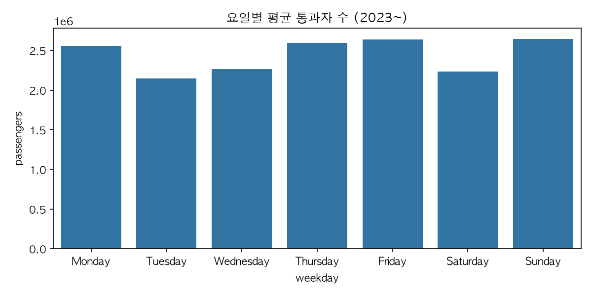
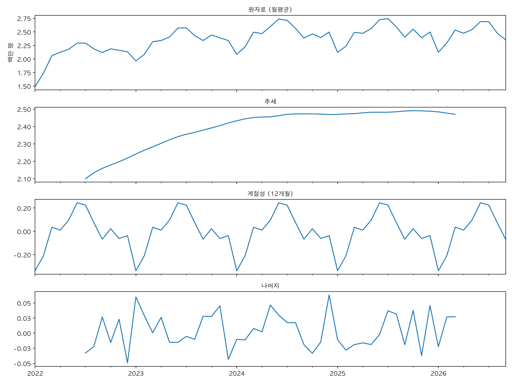
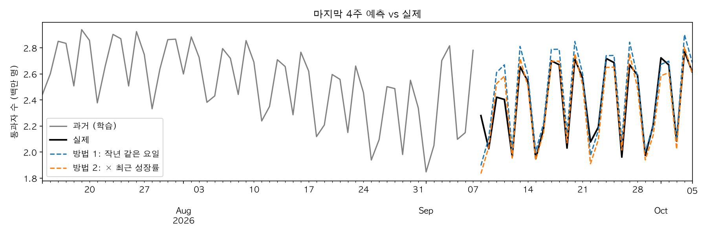

# 미국 TSA 보안검색 통과자 수 시계열 분석 리포트

## 1. 분석 주제 및 선정 이유

- 미국 공항 보안 검색대를 통과하는 사람 수를 코로나 이전인 2019년부터 매일 기록한 데이터로, 사람들이(주로 미국 사람들, 국내, 국제선 구분 없음) 언제, 얼마나 비행기를 타는지와 코로나 이후 얼마나 회복했는지 분석했다. 
- 일별 데이터라 양이 충분하고(2,835개), 요일·계절·명절·코로나 같은 변화가 그래프에 잘 드러나서 시계열 분석 연습에 적합하다고 판단했다.

## 2. 분석 질문

1. 코로나때 얼마나 줄었고,언제 원래 수준으로 돌아왔나?
2. 일년 중, 일주일 중 언제 가장 붐비나?
3. 평소 패턴에서 크게 벗어난 날은 언제고, 왜 그랬을까?

## 3. 데이터 설명

- 출처: TSA 공식 사이트 (tsa.gov/travel/passenger-volumes). 미국 정부 공개 자료
- 기간:2019-01-01\~2026-10-05
- 데이터 수: 2,835일
- 수집 방법: `collect_data.py`로 연도별 페이지의 표를 모아 `data/tsa_daily.csv`로 저장
- 주요 컬럼:
  - `date`: 날짜 (일 단위)
  - `passengers`: 그날 TSA 보안검색대를 통과한 사람 수
- 결측치/이상치 처리 기준:
  - 결측치 0개, 중복 날짜 0개 (`isna()`, `index.duplicated()`로 확인)
  - IQR 기준(Q1 − 1.5×IQR 미만, Q3 + 1.5×IQR 초과)으로는 274일이 이상치로 나왔는데, 전부 코로나 기간(2020-03-18 \~ 2021-03-09)이었다. 전체 분포로만 보면 명절이나 날씨 같은 하루짜리 변화는 잡지 못한다.
  - 그래서 **같은 요일의 최근 4주 중앙값**을 기준값으로 두고, 이 값에서 ±25% 넘게 벗어난 날을 이상치로 봤다. 2022년 이후 52일이 해당됐다.
  - 이상치는 기록 오류가 아니라 실제 사건(코로나, 명절, 날씨 등)이라고 판단해 **삭제하지 않고** 해석 대상으로 남겼다.

## 4. 분석 결과 및 시각화

### 4-1. 전체 추이

- 관찰: 2019년에는 하루 약 200만\~270만 명이었는데, 2020년 3월부터 급감해서 2020-04-14에 11만 3천 명으로 최저를 기록했다(2019년 평균의 약 5%). 이후 천천히 회복해서 2022년부터는 다시 200만 명대가 됐다.

### 4-2. 이동평균

- 관찰: 원자료는 요일 때문에 매일 크게 오르내려서 흐름이 잘 안 보인다. 7일 이동평균을 쓰면 요일 효과가 상쇄돼 주 단위 흐름이 보이고, 30일 이동평균에서는 매년 여름에 올라가고 1\~2월에 내려가는 반복 패턴이 뚜렷하다.
- 연평균: 2019년 232만 → 2020년 93만 → 2021년 160만 → 2022년 208만 → 2023년 235만 → 2024년 247만 → 2025년 248만 (2026년은 10월까지라 비교에서 제외)

### 4-3. 월별 집계 (권장)

- 관찰: 2023\~2025년 기준 6·7월이 일평균 약 268만 명으로 가장 많고, 1월이 약 206만 명으로 가장 적다. 달마다 날짜 수가 달라서(28\~31일) 합계 대신 일평균으로 비교했다.

### 4-4. 요일별 평균

- 관찰: 2023년 이후 기준 일요일(약 265만)·금요일(약 264만)·목요일이 가장 많고, 화요일(약 215만)이 가장 적다. 가장 많은 요일과 적은 요일의 차이가 약 50만 명(약 23%)이다. 코로나 영향을 빼기 위해 2023년 이후만 사용했다.

## 5. 인사이트

### 인사이트 1. 코로나 이후 2023년에 완전히 회복했지만, 2024년부터는 성장이 멈췄다
- 관찰(Fact): 2020-04-14에 11만 3천 명으로 최저를 기록했고, 연평균은 2023년(235만)에 2019년(232만)을 처음 넘었다. 그러나 2024년 247만, 2025년 248만으로 증가 폭이 거의 없다. 시계열 분해(보너스)에서도 추세선이 2024년 이후 평평하다.
- 해석(가설): 코로나 이후 억눌렸던 여행 수요(보복 여행)가 2023\~2024년에 다 풀리면서 회복기가 끝나고, 이제는 정상적인 수준에서 유지되는 단계로 보인다. 항공권 가격이나 경기 영향일 수도 있다.
- 행동(Action): 항공권 가격, 소비자 지출 같은 외부 데이터와 함께 비교해서 정체 원인을 확인해 볼 수 있다.

### 인사이트 2. 미국 사람들은 "주말 앞뒤"와 "여름"에 가장 많이 난다
- 관찰(Fact): 요일별로는 일요일·금요일·목요일이 가장 많고 화요일·수요일·토요일이 적다. 월별로는 6·7월이 가장 많고 1·2월이 가장 적다. 시계열 분해 결과 6월은 평균보다 약 25만 명 많고, 1월은 약 34만 명 적다.
- 해석(가설): 금요일에 떠나 일요일에 돌아오는 주말여행·출장 패턴 때문에 토요일은 오히려 적다. 여름은 학교 방학과 휴가철이 겹친다.
- 행동(Action): 여행자라면 화요일·수요일이나 1\~2월에 이동하면 공항이 덜 붐빈다. 항공사·공항은 일요일과 여름 성수기에 인력을 더 배치해야 한다.

### 인사이트 3. 명절 당일은 오히려 한산하고, 그 앞뒤로 몰린다
- 관찰(Fact): 8년 중 가장 붐빈 날은 2025-11-30(추수감사절 다음 일요일, 313만 명)이다. 반대로 추수감사절 당일은 2022\~2025년 매년 평소 같은 요일보다 약 38\~40% 적었다. 추수감사절 이틀 전(2024-11-26)은 평소보다 약 39% 많았다.
- 해석(가설): 명절 당일에는 가족과 함께 있고, 이동은 그 전후에 몰리기 때문이다.
- 행동(Action): 연휴 기간 예측은 "명절 날짜 기준 며칠 전·후"로 따로 계산해야 정확하다. 작년 같은 요일만 보는 단순 예측(보너스)은 명절 날짜가 바뀌면 틀릴 수 있다.

### 참고: 그 밖의 이상치
- 2022년 1월에 같은 요일 최근 4주 중앙값보다 25% 넘게 적은 날이 10일이었다(가장 큰 날 1/11, −38%).
  - 기준 확인: 1월은 기준값(최근 4주)에 연말 연휴가 들어가서 매년 어느 정도 낮게 나온다. 그래서 다른 해 1월과 비교했다. −25% 넘는 날이 2023년 0일, 2024년 3일, 2025년 3일인데 2022년은 10일이었다. 2019년 1월 일평균과 비교해도 2022년 1월은 −25%, 2023년 1월은 −1%였다. 즉, 연휴 직후의 평범한 감소보다 확실히 컸다.
  - 외부 자료: 같은 시기 미국 코로나 확진자 7일 평균이 2022-01-15에 약 80만 명으로 당시 최고였다(CDC). 2022년 1월 국내선 결항률은 6.3%로, 미 교통부는 오미크론 확산이 항공 일정과 운항에 큰 변화를 일으켰다고 밝혔다([DOT](https://www.transportation.gov/briefing-room/air-travel-consumer-report-january-2022-numbers)). 2022년 1월 미국 항공사 탑승객은 2020년 1월보다 34% 적었고, BTS는 오미크론 우려를 원인으로 꼽았다([BTS](https://www.bts.gov/newsroom/us-scheduled-service-airline-january-2022-passengers-increased-33-2021-decreased-34-pre)). 단, BTS 수치는 월간 항공사 탑승객 통계라 TSA 일별 통과 인원과는 다른 지표다.
  - 해석: 2022년 1월의 감소에는 오미크론 확산에 따른 수요 위축과 운항 차질이 기여한 것으로 보인다. 다만 연휴 직후 계절적 감소와 날씨 등 다른 요인도 함께 작용했을 수 있어서, 감소분 전체를 오미크론 탓으로 보기는 어렵다.
- 2026-01-25(일)는 131만 명으로, 최근 4주 일요일 중앙값(약 261만)보다 약 50% 적어서 코로나 이후 가장 큰 하락이었다.
  - 원인: 미국 남부에서 북동부까지 휩쓴 대형 겨울폭풍. 이날 하루 1만 1,400편 이상이 결항했고, 항공 분석업체 Cirium은 코로나 이후 최대 규모의 결항 사태라고 설명했다. ([AP 보도](https://apnews.com/article/871ea9cf98ec399bce4dccf0cffa2c01))
  - 데이터에서도 폭풍 경로와 같은 흐름이 보인다: 1/23(금) −14% → 1/24(토) −30% → 1/25(일) −50% → 1/26(월) −28% → 1/27(화) −9% → 1/28(수) −1%로 사흘 만에 거의 회복.
  - 참고: 여기서 −50%는 TSA 데이터로 직접 계산한 "같은 요일 최근 4주 중앙값 대비" 수치다. 다른 기관 자료의 감소율은 비교 기준(예: 특정 날짜 대비)이 달라서 숫자가 다를 수 있다.

## 6. 결론 및 한계점

- 결론:
  - 미국 항공 이동량은 코로나로 최대 95% 가까이 줄었다가 2023년에 코로나 이전 수준을 회복했고, 2024년부터는 비슷한 수준에서 유지되고 있다.
  - 이동량에는 요일(주간)과 계절(연간)이라는 두 가지 반복 패턴이 뚜렷하고, 명절은 당일이 아니라 전후로 몰린다.
  - 이상치는 대부분 실제 사건(코로나, 명절, 2026년 1월 겨울폭풍)으로 설명할 수 있어서, 지우기보다 해석하는 것이 더 의미 있었다.
- 한계점:
  - 국내선·국제선, 출발·환승 구분이 없고, 같은 사람이 여러 번 통과하면 중복으로 세어진다.
  - 날씨, 항공권 가격, 경기 같은 원인 변수가 데이터에 없어서 해석은 가설 수준이다.
  - 2026년은 10월 5일까지만 있어서 연간 비교에서 제외했다.
  - 이상치 기준(±25%, 최근 4주)은 내가 정한 값이라, 기준을 바꾸면 결과가 달라질 수 있다.

## 7. 보너스 과제

### 대시보드
- 배포 URL: https://ijudge-tsa.streamlit.app/ (Streamlit Community Cloud)
- 기간·집계 단위·이동평균·요일을 바꿔 가며 탐색할 수 있다. 로컬 실행은 `streamlit run dashboard.py`. 실행 방법과 시나리오는 README 참고.

### 시계열 분해

- 2022-01 \~ 2026-09 월평균을 추세 + 12개월 계절성 + 나머지로 분리했다. 코로나 급락 구간은 추세를 왜곡해서 제외했다.
- 추세는 2022년 약 210만에서 2024년 약 247만까지 오른 뒤 평평하다. 계절성은 6월 +25만, 7월 +23만, 1월 −34만, 2월 −21만이다.

### 간단 예측

- 마지막 4주(2026-09-08 \~ 10-05)를 숨기고 그 이전 데이터만으로 예측했다.
  - 방법 1. 작년 같은 요일(364일 전) 값 그대로: 오차(MAPE) 3.9%
  - 방법 2. 방법 1 × 최근 4주 성장률(−3.3%): 오차(MAPE) 3.1%
- 가정: 올해도 작년과 같은 요일·계절 패턴을 따른다.
- 한계: 명절 날짜가 해마다 바뀌면 맞지 않고, 날씨 같은 돌발 상황은 예측할 수 없다. 4주만 검증했다.

## 8. AI 사용 로그

| 사용 작업 | 사용 이유 | 검증 방법 |
|---|---|---|
| TSA 사이트에서 데이터를 받아오는 코드 작성 (`collect_data.py`) | HTML 표를 읽어 오는 코드 작성 시간 절약 | 연도별 행 수가 365/366일인지 확인, 사이트 표의 값 몇 개를 csv와 직접 대조 |
| 분석 노트북의 기본 구조(셀 순서)와 그래프 코드 초안 작성 | 반복되는 전처리·시각화 코드 작성 시간 절약 | 그래프 값과 `describe()` 통계, 최고·최저일을 서로 대조 |
| 이상치를 찾는 다른 기준 제안 받기 (같은 요일 최근 4주 비교) | IQR이 코로나 기간만 잡는 문제의 대안 탐색 | 걸린 날짜가 실제 추수감사절 등 명절 날짜와 맞는지 직접 확인 |
| 시계열 분해·예측(보너스) 코드 작성 | statsmodels 사용법과 베이스라인 방법 탐색 | 예측 오차를 직접 계산하고, 그래프로 실제 값과 비교 |
| 대시보드(보너스) 코드 작성과 배포 준비 | Streamlit 화면 구성과 배포 설정 시간 절약 | 로컬과 배포 화면에서 조건을 바꿔 가며 숫자가 노트북 결과와 같은지 확인 |
| 리포트 문장 다듬기 (관찰과 해석 구분) | 관찰과 해석을 구분해 쓰는 문장 다듬기 | 모든 수치를 노트북 실행 결과와 다시 대조 |
