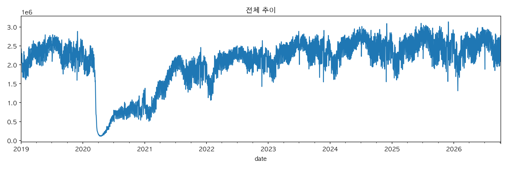
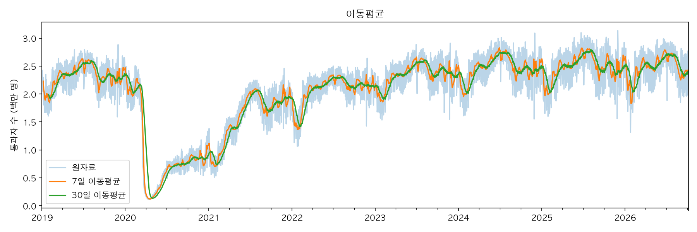
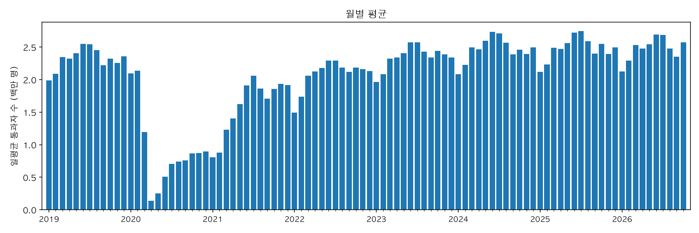

# (분석 주제) 시계열 분석 리포트

## 1. 분석 주제 및 선정 이유

- 

## 2. 분석 질문

1. 
2. 
3. 

## 3. 데이터 설명

- 출처:
- 기간:
- 데이터 수: N개
- 주요 컬럼:
- 결측치/이상치 처리 기준:

## 4. 분석 결과 및 시각화

### 4-1. 전체 추이

- 관찰:

### 4-2. 이동평균

- 관찰:

### 4-3. 월별 집계 (권장)

- 관찰:

## 5. 인사이트

### 인사이트 1
- 관찰(Fact):
- 해석(가설):
- 행동(Action):

### 인사이트 2
- 관찰(Fact):
- 해석(가설):
- 행동(Action):

### 인사이트 3
- 관찰(Fact):
- 해석(가설):
- 행동(Action):

## 6. 결론 및 한계점

- 결론:
- 한계점:

## 7. AI 사용 로그

| 사용 작업 | 사용 이유 | 검증 방법 |
|---|---|---|
|  |  |  |
